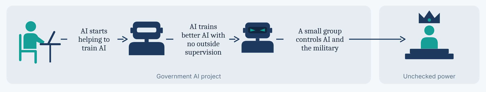
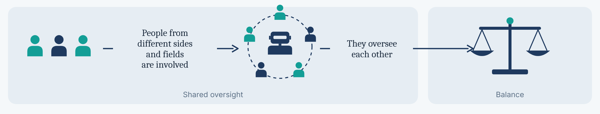

## Contents

1. [Where does this question come from?](#1-where-does-this-question-come-from)
2. [Discussion](#2-discussion)
    - 2.1 [Current state](#21-current-state)
    - 2.2 [Frontier lab or national government?](#22-frontier-lab-or-national-government)
    - 2.3 [A small group?](#23-a-small-group)
3. [Conclusion](#3-conclusion)
4. [References](#references)

---

## 1. Where does this question come from?

As costs increase dramatically, including the cost of chips and of talented researchers, the development of AI requires more and more resources and money [[1]](https://hai.stanford.edu/ai-index/2025-ai-index-report/research-and-development). This is analogous to a normal business war in a specific industry. If AI is actually just a normal technology [[2]](https://knightcolumbia.org/content/ai-as-normal-technology), I believe it will end up the same way: a few frontier AI labs will take control of most of the AI market, including the development of AI. But the crucial difference is that AI is generally considered more than a normal technology. People are concerned that AI will not only bring convenience and financial influence across the world, but will also affect how much power one can seek [[3]](https://www.forethought.org/research/ai-enabled-coups-how-a-small-group-could-use-ai-to-seize-power).

In the past, every technology wave caused a panic: people were scared of being replaced or fired by their firms [[4]](https://en.wikipedia.org/wiki/The_End_of_Work). One wave similar to AI is the internet. When the internet came out, the middle of the job market shrank. Meanwhile, demand for high-skill and low-skill workers actually grew [[5]](https://economics.mit.edu/sites/default/files/publications/the%20growth%20of%20low%20skill%202013.pdf). Some people argue that AI will end with the same result. This can be challenged by the fact that past technologies could "only" increase the efficiency of workers, not replace the workers themselves. To illustrate, in past technology waves a worker was always needed, whether the original workers were kept or replaced by higher-skilled or lower-skilled workers. However, in the AI wave, it is now possible to simply cut the worker and use AI instead [[6]](https://arxiv.org/abs/2501.16946). This is not only about unemployment; it is worth noting that a person who uses AI could do everything by himself with AI. This is where the "one-person company" comes from [[7]](https://fortune.com/2024/02/04/sam-altman-one-person-unicorn-silicon-valley-founder-myth): one person can hold all the power in the company, because the company's performance no longer depends on team members, but only on that person and the AIs, which are in some sense equivalent to the person himself.

<figure class="article-figure" id="figure-1">
  
  <figcaption>Figure 1. From a team to a one-person company.<a href="/assets/personal/ai-safety-2035/fig1_one_person_company.png" target="_blank" rel="noopener" aria-label="View Figure 1 in full size (opens in a new tab)">View full size</a></figcaption>
</figure>

This leads to today's question: will a certain group of people be able to use AI to seize power? Will it be the frontier labs, the national governments, or a small group?

---

## 2. Discussion

### 2.1 Current state

In current AI development, there is a big gap between industry and academic research. 91% of notable AI models come from industry, while only 2% come from academia [[8]](https://hai.stanford.edu/assets/files/ai_index_report_2026_chapter_1_research_development.pdf). This can be explained by another comparison: 80% of AI supercomputer capacity is owned by companies, not by research institutions or governments [[9]](https://epoch.ai/blog/trends-in-ai-supercomputers). All of this information points to the complete lead of the frontier AI labs. Will this situation be maintained until 2035?

### 2.2 Frontier lab or national government?

One of the biggest problems for an ideal one-person company is trust. In the past, when performance was not ideal, we could argue that one of the team members (components) was holding the team back, and that person would take responsibility. However, when it comes to your AI worker, even if you suspect that the AI worker is not as satisfactory as before, you cannot do anything about the provider. Even if the provider has not actually lowered its performance, you will still doubt it, because the AI is a black box [[10]](https://arxiv.org/abs/2406.07358) and you have no sense of control over these AI bots, whereas you are able to "control" and "trust" your workers through salary and the threat of unemployment.

There is a similar trust issue between governments and frontier AI labs. Nowadays, there is no doubt that national governments hold most of the power. They control the military, and they are responsible for political events and all the big decisions. When AI develops so fast that it can make significant contributions to governments, will governments believe that frontier AI labs are giving them the best models? This is the trust problem: they will never believe it unless they know the complete details of all the frontier labs.

Can the frontier labs fight back? It will not happen unless there is a significant change, with something other than AI emerging, because all of these models rely on chips and the internet. They are all based on hardware [[11]](https://arxiv.org/abs/2402.08797). If so, the national government, which controls the military, will always have the right to make the final decision on the frontier labs' fate. This leads to the result that the frontier labs are the least likely to maintain their leading position and seize power, and they will in some way become part of the national government [[12]](https://situational-awareness.ai/the-project/).

<figure class="article-figure" id="figure-2">
  
  <figcaption>Figure 2. Why the frontier lab ends up inside the state.<a href="/assets/personal/ai-safety-2035/fig2_lab_vs_government.png" target="_blank" rel="noopener" aria-label="View Figure 2 in full size (opens in a new tab)">View full size</a></figcaption>
</figure>

It is worth considering a very special scenario in which the frontier labs also have military power [[13]](https://defensescoop.com/2025/07/14/pentagon-ai-contracts-musk-xai-google-openai-anthropic-cdao/), even though it would definitely be highly restricted by the government. They might have autonomous robot systems that do not need human soldiers to cooperate [[3]](https://www.forethought.org/research/ai-enabled-coups-how-a-small-group-could-use-ai-to-seize-power). This might change the distribution of military power all over the world, causing complete confusion in AI development, and even in world development.

### 2.3 A small group?

Since we suggest that national governments will lead most AI development, it is worth discussing whether a small group of people (inside the government) will take charge of it. It seems that AI has recently become able to help train AI [[14]](https://deepmind.google/discover/blog/alphaevolve-a-gemini-powered-coding-agent-for-designing-advanced-algorithms/). Will this develop until AI can train better AI without human assistance [[15]](https://ai-2027.com/)? In that case, will the people who hold the latest models and have access to the supercomputer capacity take over all frontier AI development? They would be the only ones in charge of training AI. This would be extremely dangerous if they could train AI according to their own preferences without others' supervision [[3]](https://www.forethought.org/research/ai-enabled-coups-how-a-small-group-could-use-ai-to-seize-power). It would be even more alarming if such people came from the national government. If a person controls both frontier AI and military power, he could become so powerful that he cannot be restrained. This would definitely be harmful to human development overall.

<figure class="article-figure" id="figure-3">
  
  <figcaption>Figure 3. How a small group inside government could take over.<a href="/assets/personal/ai-safety-2035/fig3_small_group.png" target="_blank" rel="noopener" aria-label="View Figure 3 in full size (opens in a new tab)">View full size</a></figcaption>
</figure>

Therefore, such small-group control of development should be prevented, and more people from different sides and fields should be brought in and involved, so they can oversee each other and form a balance.

---

## 3. Conclusion

I would suggest that national governments will maintain their positions and seize more power than the frontier labs. A small group of AI "leaders" should not be permitted, and more people should be involved here.

<figure class="article-figure" id="figure-4">
  
  <figcaption>Figure 4. Shared oversight as the remedy.<a href="/assets/personal/ai-safety-2035/fig4_balance.png" target="_blank" rel="noopener" aria-label="View Figure 4 in full size (opens in a new tab)">View full size</a></figcaption>
</figure>

---

## References

1. Stanford HAI, [*AI Index Report 2025*, Chapter 1: Research and Development](https://hai.stanford.edu/ai-index/2025-ai-index-report/research-and-development) (2025). Rising training costs, e.g. about $170M for Llama 3.1-405B.
2. Arvind Narayanan and Sayash Kapoor, ["AI as Normal Technology"](https://knightcolumbia.org/content/ai-as-normal-technology), Knight First Amendment Institute (April 2025).
3. Tom Davidson, Lukas Finnveden and Rose Hadshar, ["AI-Enabled Coups: How a Small Group Could Use AI to Seize Power"](https://www.forethought.org/research/ai-enabled-coups-how-a-small-group-could-use-ai-to-seize-power), Forethought (April 2025).
4. Jeremy Rifkin, [*The End of Work*](https://en.wikipedia.org/wiki/The_End_of_Work) (1995). An example of past fears of technological unemployment.
5. David Autor and David Dorn, ["The Growth of Low-Skill Service Jobs and the Polarization of the US Labor Market"](https://economics.mit.edu/sites/default/files/publications/the%20growth%20of%20low%20skill%202013.pdf), *American Economic Review* 103(5) (2013).
6. Jan Kulveit et al., ["Gradual Disempowerment: Systemic Existential Risks from Incremental AI Development"](https://arxiv.org/abs/2501.16946) (January 2025).
7. Paolo Confino, ["Could AI create a one-person unicorn? Sam Altman thinks so"](https://fortune.com/2024/02/04/sam-altman-one-person-unicorn-silicon-valley-founder-myth), *Fortune* (February 2024).
8. Stanford HAI, [*AI Index Report 2026*, Chapter 1: Research and Development](https://hai.stanford.edu/assets/files/ai_index_report_2026_chapter_1_research_development.pdf) (2026). Industry produced 93 of 102 notable models in 2025; academia alone produced 2.
9. Konstantin Pilz et al., ["Trends in AI Supercomputers"](https://epoch.ai/blog/trends-in-ai-supercomputers), Epoch AI (April 2025). Companies' share of AI supercomputer performance rose from about 40% (2019) to 80% (2025).
10. Teun van der Weij et al., ["AI Sandbagging: Language Models can Strategically Underperform on Evaluations"](https://arxiv.org/abs/2406.07358) (2024).
11. Girish Sastry et al., ["Computing Power and the Governance of Artificial Intelligence"](https://arxiv.org/abs/2402.08797) (February 2024).
12. Leopold Aschenbrenner, [*Situational Awareness*, "IV. The Project"](https://situational-awareness.ai/the-project/) (June 2024).
13. Mikayla Easley, ["Pentagon awards mega contracts to Musk-owned company, other firms for new 'frontier AI' projects"](https://defensescoop.com/2025/07/14/pentagon-ai-contracts-musk-xai-google-openai-anthropic-cdao/), DefenseScoop (July 2025). Contracts worth up to $200M each to Anthropic, Google, OpenAI and xAI.
14. Google DeepMind, ["AlphaEvolve: A Gemini-powered coding agent for designing advanced algorithms"](https://deepmind.google/discover/blog/alphaevolve-a-gemini-powered-coding-agent-for-designing-advanced-algorithms/) (May 2025). It cut Gemini's training time by about 1%.
15. Daniel Kokotajlo et al., [*AI 2027*](https://ai-2027.com/) (April 2025). A scenario in which AI automates AI research.
